# IAOP — AGENT SERVICE + AGENCY SERVICE + AGENT BFF
## Phase 0 Initial Audit & Baseline Matrix

**Date:** 2026-11-14  
**Branch:** `development`  
**Workspace:** `C:\Users\LENOVO\Development\agentapr\iaop-workspace`  
**Evaluator:** Principal Enterprise Architect, Principal Rust Engineer, Security Architect  

---

## 1. Verified Repository Baselines

| Repository | Latest Commit SHA | Working Tree Status | Remote Branch Status |
| :--- | :--- | :--- | :--- |
| **`iaop-agent-service`** | `0dfcd703fcfb534af72e9842c4d9fa6fab13cceb` | Clean | `origin/development` in sync |
| **`iaop-agency-service`** | `e3f703e37d28d2c369833337b0595b65f72dc770` | Clean | `origin/development` in sync |
| **`iaop-agent-bff`** | `c5a2056d369e60cc8bb87e0667f42d769418d2a2` | Clean | `origin/development` in sync |

---

## 2. Capability Audit & Gap Analysis

### 2.1 `iaop-agent-service`

| Area / Capability | Current Status | Audit Finding & Required Remediation |
| :--- | :--- | :--- |
| **Agent Registry & CRUD** | `IMPLEMENTED_AND_VERIFIED` | Full entity, commands (`create_agent`, `get_agent`, `list_agents`, `get_by_code`), code uniqueness enforced. |
| **Lifecycle State Machine** | `IMPLEMENTED_AND_VERIFIED` | Draft -> PendingActivation -> Active -> Suspended -> Reinstated -> Terminated transitions enforced in domain aggregate with audit history. |
| **Activation Authorization** | `PARTIAL` | Only `FailClosedActivationAuthz` (returns Indeterminate) and `FixtureActivationAuthz` (returns Allow) exist. Must implement real configurable adapter supporting signed/durable decision verification or external eligibility validation, failing closed on Indeterminate. |
| **Suspension & Reinstatement** | `IMPLEMENTED_AND_VERIFIED` | Domain transitions and audit events exist. Needs security integration distinguishing administrative active vs permitted to sell, and cross-service propagation. |
| **Identity Links** | `IMPLEMENTED_AND_VERIFIED` | Links OIDC subject to AgentId; unlink history preserved. |
| **Appointments** | `IMPLEMENTED_AND_VERIFIED` | Appointments persisted with effective dates and history. |
| **Database & Migrations** | `IMPLEMENTED_AND_VERIFIED` | SQLx migrations `20261114000001_agent_registry.sql`, `20261114000002_outbox_delivery.sql`. Idempotency and audit tables present. |
| **Transactional Outbox** | `PARTIAL` / **UNSAFE CLAIM** | `claim_batch` performs `SELECT ... FOR UPDATE SKIP LOCKED` inside a short tx and commits immediately without durable leasing. If multiple instances run, row locks are released before delivery, allowing duplicate claims! Must add durable atomic lease (`claimed_by`, `locked_until`). |
| **Kafka Integration** | `MISSING` | Only `LogTransport` exists. Must implement real Kafka transport using maintained pure Rust async client (`rskafka`), publish to canonical topics (`agent.created`, `agent.activated`, etc.) using canonical envelope. |
| **Kafka Consumer / Inbox** | `SCAFFOLD` | Inbox table exists in migrations; consumer for external eligibility/compliance updates is not wired. |

### 2.2 `iaop-agency-service`

| Area / Capability | Current Status | Audit Finding & Required Remediation |
| :--- | :--- | :--- |
| **Agency Master CRUD** | `IMPLEMENTED_AND_VERIFIED` | `create_agency`, `list_agencies`, `get_agency` implemented with database persistence. |
| **Organizational Hierarchy** | `IMPLEMENTED_AND_VERIFIED` | Unit creation, reparenting with cycle detection, ancestors/descendants recursive queries, temporal hierarchy as-of date. |
| **Agent Assignments** | `PARTIAL` | Assign agent to unit, current assignment, historical assignment exist. Gap: Agent existence is not validated against Agent Registry (arbitrary UUIDs accepted). Must add authoritative validation adapter. |
| **Agency Transfers** | `IMPLEMENTED_AND_VERIFIED` | Transfer request, effective reassignment, history preservation, idempotency. |
| **Leadership Appointments** | `IMPLEMENTED_AND_VERIFIED` | Assign leader, end appointment, query leaders as-of date. |
| **Database & Migrations** | `IMPLEMENTED_AND_VERIFIED` | Migrations `000001` through `000006` cover outbox, inbox, agency, audit, leadership, idempotency. Real DB tests exist in `tests/db_tests.rs`. |
| **Transactional Outbox** | `PARTIAL` / **UNSAFE CLAIM** | Same unsafe claim pattern as Agent Service. Must implement durable lease and retry backoff with jitter. |
| **Kafka Integration** | `MISSING` | Only `LogTransport` exists. Must implement Kafka publisher for agency topics (`agency.created`, `agency.unit-created`, `agency.hierarchy-changed`, `agency.agent-assigned`, `agency.agent-transferred`, etc.). |
| **Cross-Service Validation** | `MISSING` | Agency does not query Agent Registry to verify agent status before assignment. |

### 2.3 `iaop-agent-bff`

| Area / Capability | Current Status | Audit Finding & Required Remediation |
| :--- | :--- | :--- |
| **OIDC Auth Flow** | `IMPLEMENTED_AND_VERIFIED` | Authorization Code + PKCE S256, state, nonce, JWKS validation via `iaop-security`. |
| **Session Persistence** | `PARTIAL` | `main.rs` hardcodes `InMemorySessionStore::new()`, completely ignoring `PgSessionStore` even when `db` is available! Must wire `PgSessionStore` when `db` is present, and fail startup if missing in production. |
| **Session Token Encryption** | `MISSING` | `bff_sessions` table stores `access_token` and `refresh_token` in plain text with a comment deferring encryption! Must implement authenticated AES-256-GCM encryption with `SESSIONS_ENCRYPTION_KEY`. |
| **CSRF Protection** | `IMPLEMENTED_AND_VERIFIED` | Cookie-to-header CSRF validation middleware tested and working. |
| **Downstream Clients** | `PARTIAL` | `AgentClient` exists. `AgencyClient` is completely missing! Must implement typed `AgencyClient` consuming `iaop-agency-service` REST API. |
| **Today Dashboard** | `SCAFFOLD` / **SYNTHETIC** | Hardcoded tasks (`tsk-001`), hardcoded customer attention count (2), hardcoded open claims (0), default `is_eligible=true`! Must remove synthetic data and compose real partial state. |
| **Agency Endpoints** | `SCAFFOLD` / **SYNTHETIC** | `get_hierarchy` and `get_my_team` return hardcoded static arrays (`GA-001`, `AGT-JKT001`). Must consume real `AgencyClient`. |
| **Sales Endpoints** | `SCAFFOLD` / **SYNTHETIC** | Hardcoded illustration premiums (`12000000.00`) and fabricated proposal submission (`PROP-...`, status `SUBMITTED`) even when Sales service does not exist! Must return explicit 503 dependency-unavailable. |
| **Task Delegation** | `SCAFFOLD` / **SYNTHETIC** | `update_task` returns fake JSON `"status": "UPDATED"`. Must reject or delegate authoritatively. |

---

## 3. Immediate Remediation Action Plan

```mermaid
flowchart TD
    subgraph S1["Stage 1: Outbox & Messaging Durability (Agent & Agency)"]
        Lease["Add Durable Outbox Lease\n(claimed_by, locked_until)"]
        Kafka["Implement rskafka Producer\n& Configurable Transport"]
        Topics["Wire Canonical Topics\n& Event Envelope"]
    end

    subgraph S2["Stage 2: Agent Domain & Authorization"]
        Authz["Configurable Activation Authz\n(Signed Decision / HTTP Client / Fail-Closed)"]
        Invariants["Enforce Strict Scope & Freshness Checks"]
    end

    subgraph S3["Stage 3: Agency Domain & Agent Registry Check"]
        AgentCheck["Authoritative Agent Existence Check\nbefore Assignment & Transfer"]
        AgencyOutbox["Wire Agency Outbox to Kafka"]
    end

    subgraph S4["Stage 4: BFF Security & Session Hardening"]
        PgStore["Wire PgSessionStore in main.rs"]
        AesEnc["Implement AES-256-GCM Token Encryption"]
        AgencyClient["Implement Typed AgencyClient"]
    end

    subgraph S5["Stage 5: Eliminate Synthetic BFF Behavior"]
        FixToday["Clean Today Dashboard (Real Partial Composition)"]
        FixAgency["Clean Agency Endpoints (Real AgencyClient Call)"]
        FixSales["Clean Sales Endpoints (Reject Fake Success)"]
        FixTasks["Clean Tasks (Fail Closed on Unimplemented Downstream)"]
    end

    subgraph S6["Stage 6: Comprehensive Verification"]
        Tests["Run Unit, DB, Kafka, Security, & E2E Tests"]
        Docker["Verify Container Builds & Local-Dev Compose"]
        Git["Commit to development & Push to origin/development"]
    end

    S1 --> S2 --> S3 --> S4 --> S5 --> S6
```

