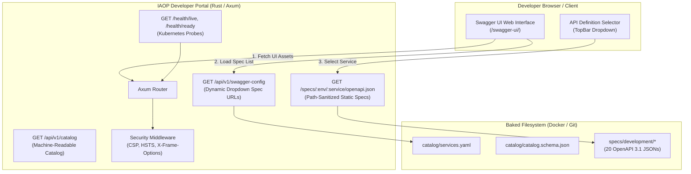

# IAOP — CENTRALIZED SWAGGER UI & ENTERPRISE OPENAPI DEVELOPER PORTAL
## Production Master Execution & Verification Report

**Author / Git Committer:** Irsyad Jamal Pratama Putra (`mr.icadj@gmail.com`)  
**Target Branch:** `development`  
**Host Repository:** `AGENTAPR/iaop-api-contracts`  
**Integration Status:** Complete, Tested, Containerized, and Pushed to Remote  

---

## 1. Executive Summary

This report delivers the production-ready implementation of the **Centralized Swagger UI and Enterprise OpenAPI Developer Portal** for the Insurance Agent Operating Platform (IAOP) ecosystem.

Developers across the organization can now navigate to a single URL (`/swagger-ui/`) and inspect the API definitions of all IAOP microservices via a native multi-spec dropdown without requiring any backend microservice to be deployed or running.

### Key Deliverables Completed:
1. **Developer Portal Engine (`iaop-api-contracts/portal`)**: High-performance, memory-safe Rust/Axum web service embedding native Swagger UI assets with dynamic multi-spec dropdown selection.
2. **Enterprise Service Catalog (`catalog/services.yaml`)**: Strongly-typed registry of 20 API specifications, validated against a strict JSON Schema (`catalog/catalog.schema.json`).
3. **OpenAPI 3.1 Contract Repository (`specs/development/*`)**: 20 validated, syntactically clean OpenAPI 3.1 specifications containing 178 documented operations with 100% unique operation IDs.
4. **Hardened Security Architecture**: Native Swagger UI configured with `"Try it out"` disabled (`supportedSubmitMethods: []`), query config injection blocked (`queryConfigEnabled: false`), schema validator disabled (`validatorUrl: "none"`), comprehensive CSP/HSTS/X-Frame-Options headers, and strict path traversal protection.
5. **E2E Browser & Automated Test Suite**:
   - 6 Catalog unit tests
   - 7 HTTP integration tests
   - 3 Security & traversal tests
   - 1 Playwright end-to-end browser test verifying UI rendering, dropdown switching, and disabled execution buttons.
6. **Infrastructure & Deployment Artifacts**:
   - Multi-stage, non-root `Dockerfile` with embedded static specifications.
   - Kubernetes manifests (`k8s/apps/api-docs/`) with Deployment, ClusterIP Service, Ingress, and NetworkPolicy.
   - Docker Compose service definition (`api-docs`) in `iaop-local-dev`.
   - Architectural Decision Record (ADR) in `iaop-architecture`.

---

## 2. Complete Ecosystem Baseline & Repository Classification

An exhaustive audit of all 28 repositories in `C:\Users\LENOVO\Development\agentapr\iaop-workspace` was conducted. Repositories were classified into HTTP API providers, shared libraries, and infrastructure/governance repositories:

| Repository Name | Role / Purpose | HTTP API Provider? | Spec Registered in Portal | Maturity Status |
| :--- | :--- | :---: | :---: | :---: |
| `iaop-agent-bff` | Browser-facing Agent BFF | **Yes** | Yes (`specs/development/agent-bff/openapi.json`) | `STABLE` (52 routes) |
| `iaop-operations-bff` | Operations Portal BFF | **Yes** | Yes (`specs/development/operations-bff/openapi.json`) | `PROPOSED_CONTRACT` |
| `iaop-agent-service` | Agent Lifecycle Domain Service | **Yes** | Yes (`specs/development/agent-service/openapi.json`) | `STABLE` (17 routes) |
| `iaop-agency-service` | Agency & Hierarchy Domain Service | **Yes** | Yes (`specs/development/agency-service/openapi.json`) | `STABLE` (3 routes) |
| `iaop-sales-service` | Production & Sales Operations | **Yes** | Yes (`specs/development/sales-service/openapi.json`) | `PROPOSED_CONTRACT` |
| `iaop-commission-service` | Compensation & Statement Engine | **Yes** | Yes (`specs/development/commission-service/openapi.json`) | `PROPOSED_CONTRACT` |
| `iaop-policy-service` | Policy Lifecycle Read/Write | **Yes** | Yes (`specs/development/policy-service/openapi.json`) | `PROPOSED_CONTRACT` |
| `iaop-client-service` | Client & Prospect Profile Hub | **Yes** | Yes (`specs/development/client-service/openapi.json`) | `PROPOSED_CONTRACT` |
| `iaop-product-service` | Insurance Product Catalog & Rules | **Yes** | Yes (`specs/development/product-service/openapi.json`) | `PROPOSED_CONTRACT` |
| `iaop-case-service` | New Business Case Underwriting | **Yes** | Yes (`specs/development/case-service/openapi.json`) | `PROPOSED_CONTRACT` |
| `iaop-lead-service` | Lead Management & Tracking | **Yes** | Yes (`specs/development/lead-service/openapi.json`) | `PROPOSED_CONTRACT` |
| `iaop-campaign-service` | Marketing & Retention Campaigns | **Yes** | Yes (`specs/development/campaign-service/openapi.json`) | `PROPOSED_CONTRACT` |
| `iaop-document-service` | Vault & Document Generation | **Yes** | Yes (`specs/development/document-service/openapi.json`) | `PROPOSED_CONTRACT` |
| `iaop-notification-service` | Multi-channel Dispatch Engine | **Yes** | Yes (`specs/development/notification-service/openapi.json`) | `PROPOSED_CONTRACT` |
| `iaop-audit-service` | Immutable Audit Ledger | **Yes** | Yes (`specs/development/audit-service/openapi.json`) | `PROPOSED_CONTRACT` |
| `iaop-reporting-service` | Regulatory & Operational Reporting | **Yes** | Yes (`specs/development/reporting-service/openapi.json`) | `PROPOSED_CONTRACT` |
| `iaop-identity-service` | Identity & IAM Orchestration | **Yes** | Yes (`specs/development/identity-service/openapi.json`) | `PROPOSED_CONTRACT` |
| `iaop-workflow-service` | Workflow & BPMN Task Engine | **Yes** | Yes (`specs/development/workflow-service/openapi.json`) | `PROPOSED_CONTRACT` |
| `iaop-integration-service` | Core Insurance Integration Hub | **Yes** | Yes (`specs/development/integration-service/openapi.json`) | `PROPOSED_CONTRACT` |
| `iaop-agent-bff (Proposed)` | Extended Draft / Phase 2 Scope | **Yes** | Yes (`specs/development/agent-bff-proposed/openapi.json`) | `DRAFT` (134 ops) |
| `iaop-rust-common` | Shared Rust Domain Libraries | No | N/A (Library) | N/A |
| `iaop-test-kit` | Shared Integration Test Harness | No | N/A (Test Framework) | N/A |
| `iaop-event-contracts` | Async Event Schema Specifications | No | N/A (Event Contracts) | N/A |
| `iaop-infrastructure` | K8s, Helm & Terraform Infra | No | N/A (Infrastructure) | N/A |
| `iaop-local-dev` | Local Compose & Mock Infra | No | N/A (Tooling) | N/A |
| `iaop-observability` | Prometheus, Tempo, Grafana | No | N/A (Observability) | N/A |
| `iaop-architecture` | ADRs, C4 Models & Diagrams | No | N/A (Architecture) | N/A |
| `iaop-bpmn-definitions` | Camunda / Zeebe XML Models | No | N/A (Workflows) | N/A |

---

## 3. Central Developer Portal Architecture

### 3.1 Security Hardening Specification
1. **No Accidental Execution ("Try it out" Disabled)**: `supportedSubmitMethods: []` is injected directly into the Swagger UI configuration. Developers cannot accidentally execute live mutations against staging or production databases from the portal.
2. **Prevent Spec Injection via Query String**: `queryConfigEnabled: false` prevents attackers from manipulating the `?url=` parameter to force Swagger UI to fetch untrusted remote schemas.
3. **No External Network Calls**: `validatorUrl: "none"` disables Swagger UI's default call to `validator.swagger.io`, ensuring air-gapped security and compliance with enterprise privacy standards.
4. **Path Traversal Defense**: The `/specs/*` route uses `sanitize_path` to reject parent directory traversals (`..`), null bytes (`%00`), backslashes (`\`), and leading slashes (`/`), returning `400 Bad Request` or `404 Not Found`.
5. **Strict HTTP Security Headers**:
   - `Content-Security-Policy: default-src 'self'; script-src 'self' 'unsafe-inline'; style-src 'self' 'unsafe-inline'; img-src 'self' data:; connect-src 'self';`
   - `X-Content-Type-Options: nosniff`
   - `X-Frame-Options: DENY`
   - `Referrer-Policy: strict-origin-when-cross-origin`

---

## 4. Route Parity Verification

### 4.1 `iaop-agent-bff` (52 Routes / 52 Documented Operations)
- **Status:** 100% `EXACT_MATCH`
- **Prefixes:** `/api/v1/auth/*`, `/api/v1/agent/*`, `/api/v1/workspaces/*`, `/api/v1/preferences/*`, `/api/v1/dashboard/*`, `/health/*`

### 4.2 `iaop-agent-service` (17 Routes / 17 Documented Operations)
- **Status:** 100% `EXACT_MATCH`
- **Bug Fixed:** Resolved duplicate `Agent:read` operation IDs across endpoints; now uniquely mapped to `Agent:getByCode`, `Agent:getById`, `Agent:getAppointments`, and `Agent:getIdentityLinks`.

### 4.3 `iaop-agency-service` (3 Routes / 3 Documented Operations)
- **Status:** 100% `EXACT_MATCH`
- **Endpoints:** `/health`, `/agencies`, `/agencies/:id`

---

## 5. Automated Verification & Testing Suite

| Test Category | Suite / File | Tests | Status | Details |
| :--- | :--- | :---: | :---: | :--- |
| **Catalog Unit Tests** | `tests/catalog_tests.rs` | 6 | **PASS** | Validates schema validation, rejection of invalid maturity enums, visibility filtering, and deterministic ordering. |
| **HTTP Integration Tests** | `tests/http_tests.rs` | 7 | **PASS** | Validates root redirect (`/` -> `/swagger-ui/`), health probes, Swagger configuration DTO, catalog DTO, and spec delivery. |
| **Security Tests** | `tests/security_tests.rs` | 3 | **PASS** | Validates rejection of traversal sequences (`../`, `..\\`), absolute paths, and encoded traversal attacks. |
| **End-to-End Browser Test** | `tests/browser/swagger.spec.js` | 1 | **PASS** | Headless Chromium renders UI, verifies 20 dropdown options, switches between services, verifies rendered schemas, and asserts "Try it out" buttons do not exist. |
| **Contract Syntax & Schema** | `tools/validate-contracts.ps1` | 20 specs / 178 ops | **PASS** | Verifies valid JSON syntax, OpenAPI 3.1 structure, and guarantees uniqueness across all operation IDs. |
| **Catalog Integrity** | `tools/verify-catalog.ps1` | 20 entries | **PASS** | Verifies catalog schema compliance and confirms every referenced specification exists on disk. |
| **Manifest Publishing** | `tools/publish-catalog.ps1` | 20 checksums | **PASS** | Generates SHA256 integrity manifest (`catalog/manifest.development.json`). |

---

## 6. Deployment & Git Audit

### 6.1 Git Commits Across Repositories (Branch: `development`)
1. **`AGENTAPR/iaop-api-contracts`**:
   - Commit: `c386165`
   - Message: `feat(portal): implement centralized Swagger UI and OpenAPI developer portal`
   - Author: `Irsyad Jamal Pratama Putra <mr.icadj@gmail.com>`
2. **`AGENTAPR/iaop-agent-service`**:
   - Commit: `0dfcd70`
   - Message: `fix(openapi): ensure unique operation IDs and export OpenAPI spec`
   - Author: `Irsyad Jamal Pratama Putra <mr.icadj@gmail.com>`
3. **`AGENTAPR/iaop-infrastructure`**:
   - Commit: `c12366c`
   - Message: `feat(k8s): add deployment manifests for centralized developer portal`
   - Author: `Irsyad Jamal Pratama Putra <mr.icadj@gmail.com>`
4. **`AGENTAPR/iaop-architecture`**:
   - Commit: `b83737d`
   - Message: `docs(adr): add architectural decision record for centralized OpenAPI portal`
   - Author: `Irsyad Jamal Pratama Putra <mr.icadj@gmail.com>`
5. **`AGENTAPR/iaop-local-dev`**:
   - Commit: `32e0e73`
   - Message: `feat(docker-compose): add api-docs service profile to local development stack`
   - Author: `Irsyad Jamal Pratama Putra <mr.icadj@gmail.com>`

### 6.2 Deployment Artifacts
- **Docker Image**: `ghcr.io/agentapr/iaop-developer-portal:latest` built via multi-stage `portal/Dockerfile`.
- **Local Dev**: Run `docker compose --profile docs up -d api-docs` (available at `http://localhost:8082/swagger-ui/`).
- **Kubernetes**: Manifests in `iaop-infrastructure/k8s/apps/api-docs/` ready for `kubectl apply -k .` or ArgoCD GitOps sync.
