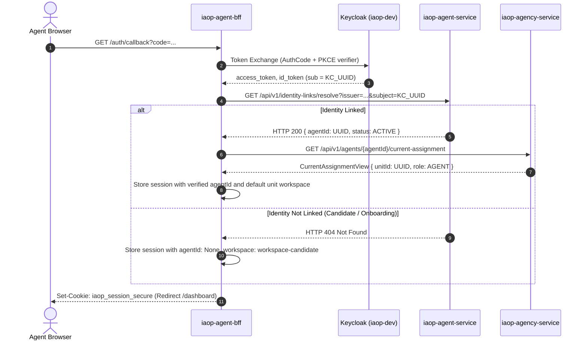

# IAOP Identity and Workspace Resolution Specification
**Authoritative Identity Linkage and Dynamic Multi-Tenant Workspace Resolution**

---

## 1. Identity Link Resolution Architecture

In IAOP, an external OpenID Connect identity (`issuer` + `subject`) does not inherently equal an internal `agent_id`. Identity linkages are maintained as authoritative domain entities in `iaop-agent-service`.

---

## 2. Dynamic Workspace Derivation Rules

Workspaces are resolved dynamically on each query (`GET /api/v1/me/workspaces`) and validated on selection (`POST /api/v1/me/workspaces/select`):
1. **Primary Assigned Unit:** Derived from `agency_client.get_current_assignment(agent_id)`. Yields workspace with unit name, agency code, and assignment role (`PRIMARY`, `SECONDARY`).
2. **Ancestor Units:** Derived from `agency_client.get_ancestors(unit_id)`. Yields management oversight workspaces for unit leaders.
3. **Candidate Workspace:** Fallback granted to unlinked applicants and onboarding candidates without active agency assignments.
4. **Authoritative Switching Validation:** `select_workspace` checks that the target `workspace_id` exists in the permitted workspace list. Attempting to select an unauthorized workspace is rejected with `HTTP 403 Forbidden` and audited.
