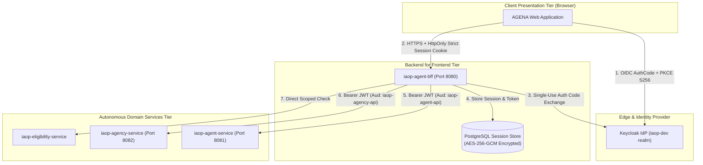

# IAOP Security Architecture Specification & Reference Standard
**Enterprise-Grade Reference Architecture for Microservices and BFF Security**

---

## 1. Architectural Overview & Security Boundary Model

The Insurance Agent Operations Platform (IAOP) implements a Zero-Trust, Defense-in-Depth security model. The architecture strictly partitions responsibility between the presentation tier (AGENA Frontend), the orchestration tier (IAOP Agent BFF), the identity provider (Keycloak), and autonomous domain services (`iaop-agent-service`, `iaop-agency-service`, and downstream domain engines).

### Key Architectural Invariants
1. **Frontend Zero-Token Exposure:** The browser NEVER receives OAuth access tokens, refresh tokens, or client credentials. Only an encrypted `HttpOnly`, `SameSite=Lax`, `Secure` session cookie (`iaop_session_secure` / `iaop_session`) and CSRF tokens are exposed to client JavaScript.
2. **Autonomous Domain Verification:** Domain services NEVER trust the BFF implicitly. Every domain endpoint validates incoming Bearer JWT signatures against Keycloak JWKS, verifies audience pinning (`iaop-agent-api`, `iaop-agency-api`), validates token expiration, and applies resource-level ABAC.
3. **Fail-Closed Downstream Fallbacks:** If an upstream authoritative service (such as Agent Registry or Eligibility Engine) is unconfigured or unreachable, calling services fail closed (returning typed `503 Service Unavailable` or `403 Forbidden`). Fallback to development bypasses (`DevAgentValidator`, `DevBypassValidator`) is prohibited outside `ENVIRONMENT=local` and `AUTH_MODE=dev`.

---

## 2. Authentication Flow & Session Lifecycle

### 2.1 OIDC Authorization Code Flow with PKCE
Authentication utilizes RFC 7636 (PKCE S256) combined with single-use login transactions:
1. `GET /auth/login` initiates the flow, generating a cryptographically random state, nonce, and S256 code challenge (`SHA-256(verifier)`).
2. The login transaction is persisted atomically in PostgreSQL (`login_transactions` table) with a 10-minute expiry.
3. Upon user authorization at Keycloak, the browser redirects to `/auth/callback?code=...&state=...`.
4. BFF executes `atomic_claim_login_transaction`, ensuring replay attacks return `401 Unauthorized`.
5. BFF completes backend-to-backend token exchange with Keycloak, obtaining `access_token`, `refresh_token`, and `id_token`.
6. Identity Resolution: BFF queries `GET /api/v1/identity-links/resolve?issuer=...&subject=...` on `iaop-agent-service` to establish verified `agent_id`.
7. Session Creation: Session is encrypted via AES-256-GCM and stored in PostgreSQL (`user_sessions` table).

---

## 3. Domain Service Security Standards
Each microservice links the standardized `iaop-security` crate:
- **JWKS Cache & RS256 Pinning:** Public keys cached with TTL; refresh throttled to prevent cache stampedes.
- **Audience Isolation:** Reject tokens not explicitly addressed to the service's designated audience.
- **Resource-Level ABAC:** Agents restricted to own records; supervisors/managers bounded to organizational hierarchy.
